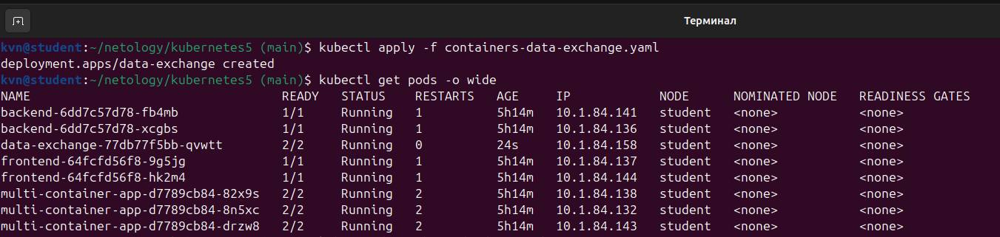
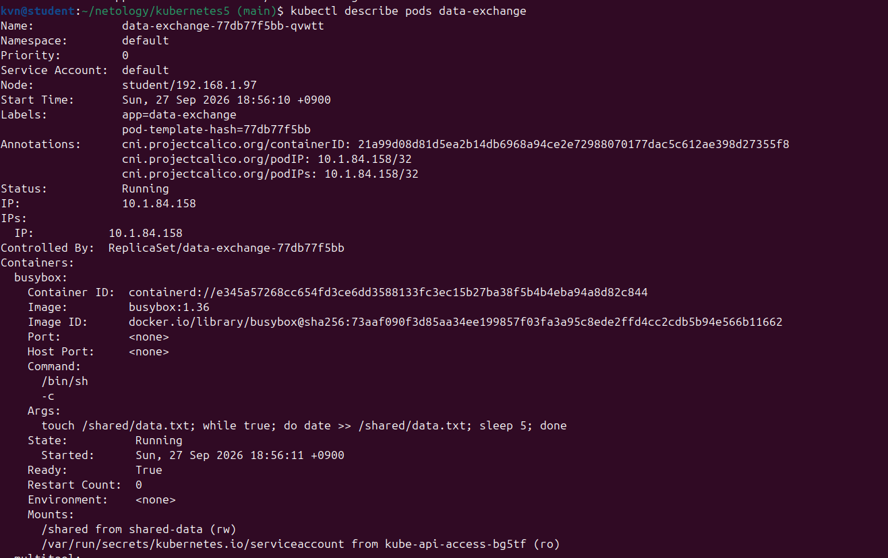
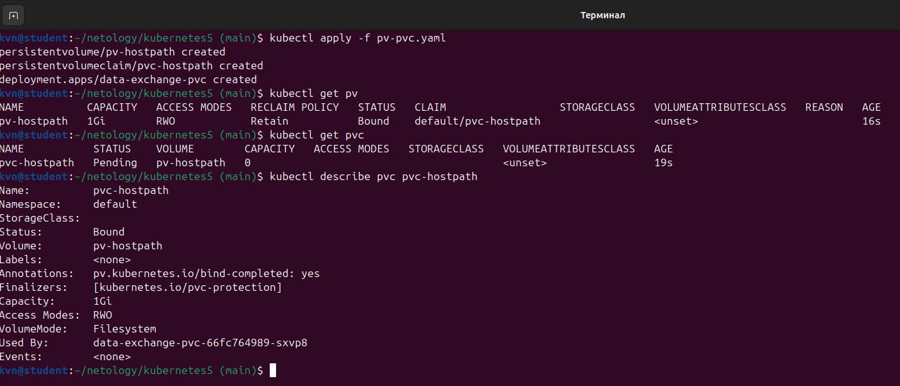
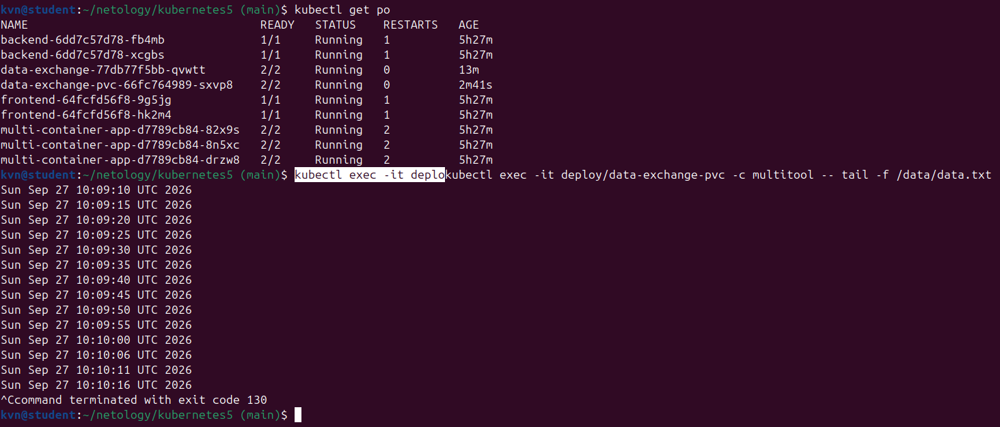
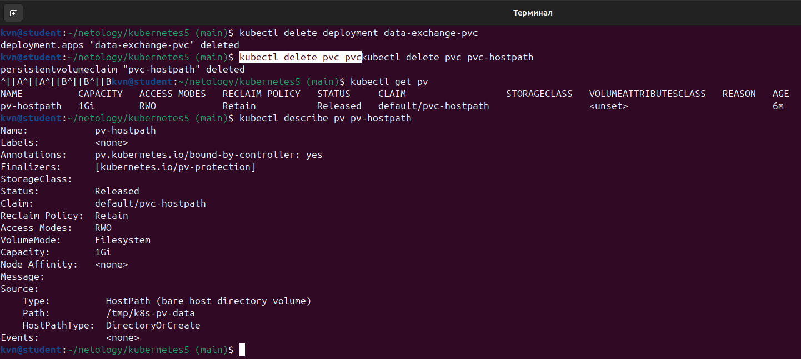
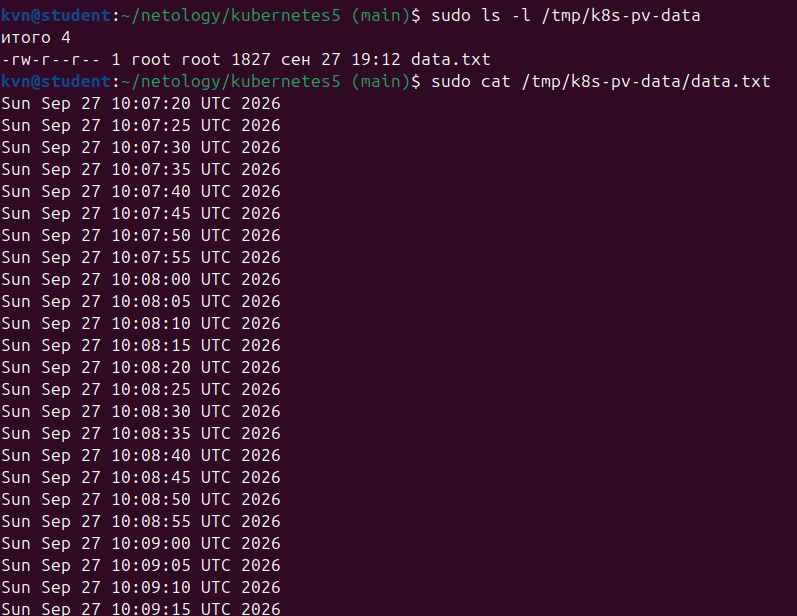
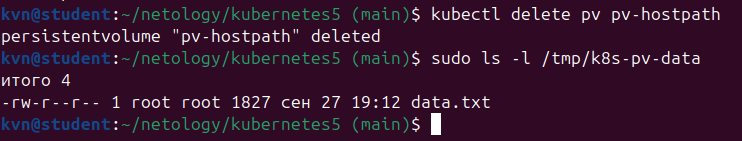
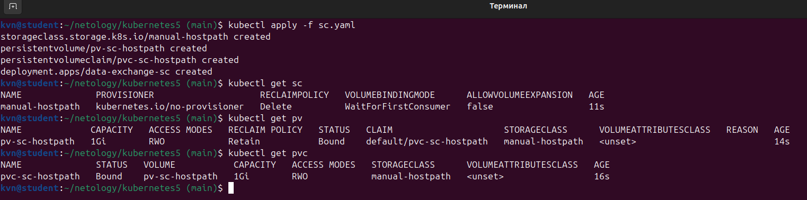
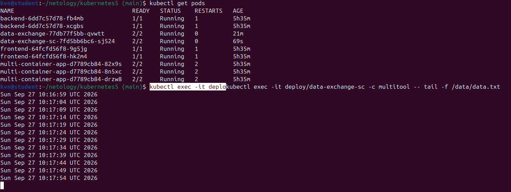

# Домашняя работа к занятию «Хранение в K8s. Часть 1»

Кластер: MicroK8s, один узел. Все команды выполнялись `kubectl` с локальной машины.

## Файлы

| Файл | Описание |
|---|---|
| [containers-data-exchange.yaml](containers-data-exchange.yaml) | Deployment из двух контейнеров и общий том `emptyDir` |
| [pv-pvc.yaml](pv-pvc.yaml) | PersistentVolume `pv-hostpath`, PVC `pvc-hostpath` и Deployment `data-exchange-pvc` |
| [sc.yaml](sc.yaml) | StorageClass `manual-hostpath`, PV `pv-sc-hostpath`, PVC `pvc-sc-hostpath` и Deployment `data-exchange-sc` |

## Обмен данными между контейнерами пода

В поде работают два контейнера. Контейнер `busybox` раз в 5 секунд дописывает текущее время
в файл `/shared/data.txt`, контейнер `multitool` читает тот же файл командой `tail -f`.
Оба контейнера монтируют один том `shared-data` типа `emptyDir`. Том объявлен на уровне пода,
поэтому файл в них один и тот же.

```bash
kubectl apply -f containers-data-exchange.yaml
kubectl get pods -o wide
kubectl describe pods data-exchange
```

В описании пода видно два контейнера и том `shared-data` типа `emptyDir`.



Чтение файла из второго контейнера:

```bash
kubectl exec -it <имя пода> -c multitool -- tail -f /shared/data.txt
```

Новая строка с датой появляется раз в 5 секунд: её дописывает первый контейнер.



## Ручное создание PersistentVolume и PersistentVolumeClaim

Том `pv-hostpath` объёмом 1Gi указывает на папку `/tmp/k8s-pv-data` на узле кластера.
Заявка `pvc-hostpath` занимает именно этот том (поле `volumeName`), а под получает его
по имени заявки. Политика возврата тома — `Retain`.

Создание тома, заявки и пода:

```bash
kubectl apply -f pv-pvc.yaml
kubectl get pv
kubectl get pvc
kubectl describe pvc pvc-hostpath
```

Заявка переходит в состояние `Bound`, в её описании видны имя тома и объём 1Gi.



Проверка, что второй контейнер читает данные с постоянного тома:

```bash
kubectl get pods
kubectl exec -it <имя пода> -c multitool -- tail -f /data/data.txt
```



Удаление пода и заявки, чтобы посмотреть на состояние тома:

```bash
kubectl delete deployment data-exchange-pvc
kubectl delete pvc pvc-hostpath
kubectl get pv
kubectl describe pv pv-hostpath
```

После удаления заявки том переходит в состояние `Released`. Политика `Retain` сохраняет
и том, и данные, поэтому в поле `Claim` остаётся имя удалённого PVC `pvc-hostpath`.
Чтобы занять том снова, нужно убрать `claimRef` или создать том заново.



Проверка файла на узле кластера:

```bash
sudo ls -l /tmp/k8s-pv-data
sudo cat /tmp/k8s-pv-data/data.txt
```

Файл на месте: `hostPath` — это обычная папка на узле, данные не зависят от объектов кластера.

Удаление самого тома и повторная проверка папки:

```bash
kubectl delete pv pv-hostpath
sudo ls -l /tmp/k8s-pv-data
```

Файл остаётся и после удаления PV: удаляется только запись о томе, папка на узле не меняется.
С политикой `Delete` том очищался бы вместе с заявкой.





## StorageClass и PersistentVolumeClaim

Класс `manual-hostpath` использует провижионер `kubernetes.io/no-provisioner`: тома кластер
сам не создаёт, том `pv-sc-hostpath` описан здесь же вручную. Без него заявка осталась бы
в состоянии `Pending`.

```bash
kubectl apply -f sc.yaml
kubectl get sc
kubectl get pv
kubectl get pvc
```

Режим `WaitForFirstConsumer` связывает заявку с томом только при появлении пода. Сразу после
применения заявка в `Pending`, после запуска пода — в `Bound`.



Чтение файла из второго контейнера, как и в предыдущем разделе:

```bash
kubectl get pods
kubectl exec -it <имя пода> -c multitool -- tail -f /data/data.txt
```


